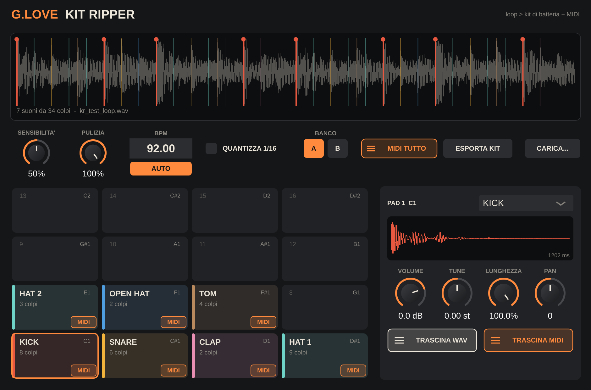

# G.LOVE Kit Ripper

Audio Unit per Logic Pro: trascini un loop, un break o lo stem di batteria e ottieni un kit di pad
(kick, snare, clap, hat, open hat, tom, perc, crash) con un file MIDI trascinabile per ogni suono.



## Come funziona
1. **Colpi** — flusso spettrale su 24 bande (basse/medie/alte pesate uguali, così gli hat contano quanto i kick), soglia adattiva, inizio preciso al campione sul segnale con pre-enfasi.
2. **Tipo** — energia *nuova* per banda (solo dove il colpo alza il livello di almeno 4 dB), decadimento, rumorosità, impulsi ravvicinati (clap).
3. **Gruppi** — i colpi dello stesso tipo che si somigliano diventano un pad.
4. **Pulizia** — i colpi del gruppo vengono allineati; la mediana spettrale tiene solo ciò che si ripete, il fondo che suonava prima del colpo viene sottratto. Fase e stereo restano quelli del colpo migliore.
5. **BPM** — autocorrelazione dei colpi, agganciato alla durata se è un loop.

## Scaricare il plugin già compilato
Ogni push su `main` compila il plugin Universal (Apple Silicon + Intel) su GitHub Actions.
Tab **Actions** → ultimo run verde → artifact **GLoveKitRipper-macOS-universal**.
Per una versione "ufficiale" crea un tag `vX.Y.Z`: lo zip finisce nelle **Releases**.

## Compilare sul proprio Mac
Doppio click su `INSTALLA.command` (vedi `LEGGIMI.txt`).

## Test del motore (anche su Linux)
```
cmake -S . -B build-test -DKR_BUILD_TESTS=ON -DKR_BUILD_PLUGIN=OFF && cmake --build build-test
./build-test/AnalyzerTest_artefacts/Release/AnalyzerTest            # loop sintetico con risultati attesi
./build-test/AnalyzerTest_artefacts/Release/AnalyzerTest loop.wav   # file vero, pad in /tmp/kr_pads
```

## Struttura
- `Source/Analyzer.*` — motore di analisi (senza GUI)
- `Source/PluginProcessor.*` — campionatore a 32 pad, export WAV/MIDI, stato
- `Source/PluginEditor.*` — interfaccia
- `Tests/` — test da riga di comando
- `.github/workflows/build.yml` — build automatica macOS
